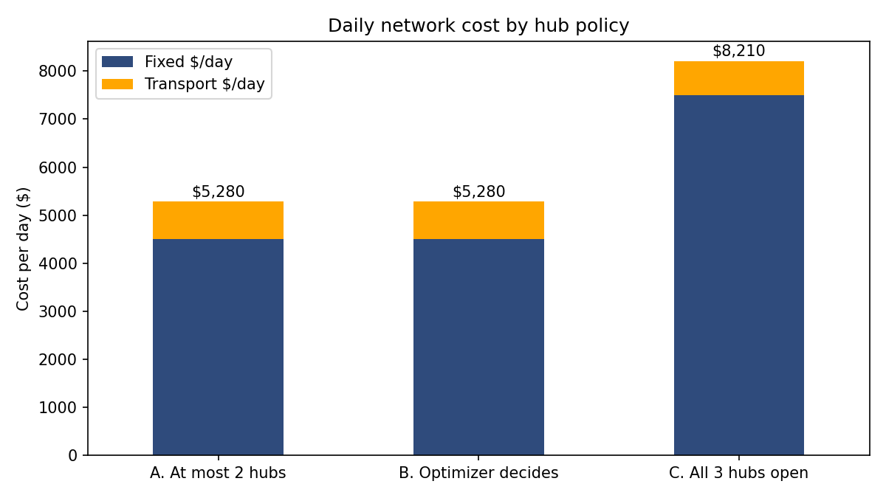
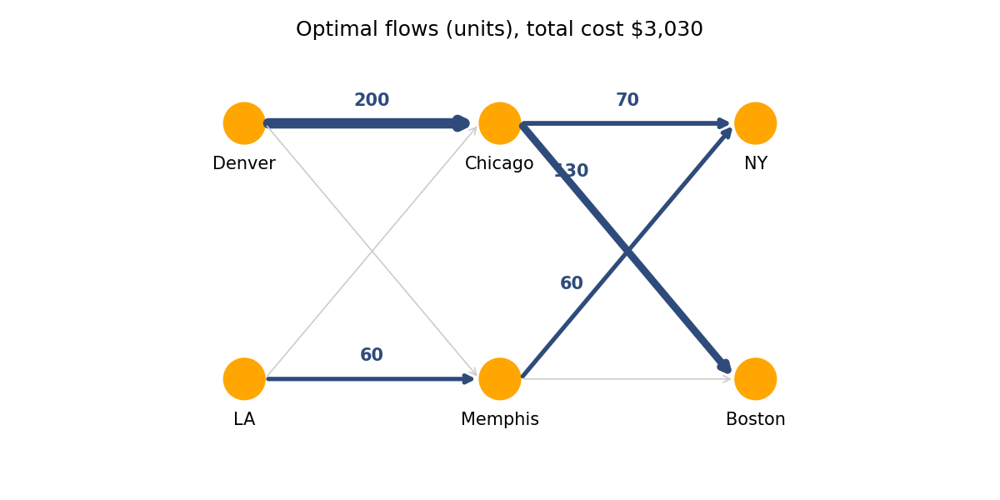

# Supply Chain Network Optimization (Python + Gurobi)

Two optimization models that answer the questions a distribution or last-mile operations team actually asks: **where should we operate, and how should product flow through the network at the lowest cost?**

| Notebook | Business question | Method | Headline result |
|---|---|---|---|
| [`hub_location_model.ipynb`](hub_location_model.ipynb) | Which delivery micro-hubs should a same-day grocery company open, and which city zones should each serve? | Facility location (mixed-integer LP) | Open 2 of 3 hubs: **$5,280/day vs $8,210/day** with all three open (-36%) |
| [`transshipment_model.ipynb`](transshipment_model.ipynb) | How should two factories ship through two DCs to two markets at minimum cost, and where is the network constrained? | Min-cost network flow (LP) + shadow prices | **$3,030** total cost; each extra unit of Denver capacity is worth **$5** |

---

## 1. Last-mile hub location

**Problem.** FreshFast serves 5 city zones (85 orders/day) and can run up to 3 micro-hubs, each with a daily fixed cost and a capacity. Transport costs $2 per km per order.

**Model.** Binary open/close decisions per hub, continuous zone-to-hub flows, demand and capacity constraints, linking constraints so orders only go to open hubs. I compared three policies and ran a transport-cost sensitivity.



**What the model recommends**
- **Open North and Central, close South.** The optimizer picks this even when it is allowed to open all three.
- **Fixed cost drives the decision.** A third hub saves only $70/day in transport but adds $3,000/day in fixed cost.
- **Central is the bottleneck** at 100% utilization, so it is the first capacity to watch as demand grows.
- **Low-regret decision:** two hubs stay optimal even if transport cost rises 15x.

## 2. Distribution network transshipment

**Problem.** Factories in Denver (200 units) and Los Angeles (150 units) ship through Chicago and Memphis to New York and Boston (130 units each). Every lane has a different per-unit cost.



**What the model shows**
- Denver's full capacity runs through Chicago, the cheapest lane. Los Angeles only tops up the shortfall via Memphis.
- **Denver capacity is the binding constraint**, with a shadow price of $5 per unit: a ready-made number for a capacity-expansion business case.
- Los Angeles uses only 60 of 150 units, so demand growth can be absorbed without new plant investment.

---

## Why this matters operationally
Network design decisions lock in cost for years. These models make the trade-off between fixed cost (more sites) and variable cost (more kilometres) explicit, identify the real bottleneck, and put a dollar value on relieving it.

## Tools
Python · Gurobi (gurobipy) · pandas · matplotlib · Jupyter

## How to run
```bash
pip install -r requirements.txt
jupyter notebook
```
Gurobi's free size-limited licence (installed with `gurobipy`) is enough for both models.

---
*Context: developed from my coursework in Managerial Decisions Modelling (UBC Sauder MBA, 2025). The hub-location model began as a group assignment and the transshipment model as an in-class exercise; both were rebuilt and extended (scenarios, sensitivity, shadow prices, visuals) for this portfolio.*
